<div align="center">



<a href="https://www.linkedin.com/in/aromal-rm/"></a>
<a href="https://github.com/aromalrm-tss?tab=repositories"></a>


</div>

<br/>

```text
$ cat /proc/aromal/status
Name:      Aromal RM
Role:      Software Engineer @ ThinkSeed Systems
Layers:    binder | native | build | linux
Platforms: AOSP, Android Automotive, Embedded Linux
Mindset:   understand the abstraction, then look beneath it
```

## What I do

I work on embedded Android and Linux-based automotive platforms, mostly **below the app layer**: native C++ services, Binder/AIDL interfaces, JNI bridges, and the build systems that tie them together. I like problems that cross boundaries (Java ↔ native, process ↔ process, framework ↔ kernel), and I treat debugging as finding out *why* it happened.

## Stack

<div align="center">

| | |
|:--|:--|
| **Platforms** | `Android` `AOSP` `Android Automotive OS` `Linux` `Embedded Linux` |
| **Languages** | `C++` `C` `Java` `Python` `Bash` |
| **Integration** | `JNI` `SWIG` `Binder` `AIDL` |
| **Build** | `Android.bp` `CMake` `cross-compilation` |
| **Tooling** | `Git` `Docker` `VS Code` |

</div>

## Contributions

<div align="center">

<!-- Snake is generated by .github/workflows/snake.yml (snake + activity graph) and pushed to the "output" branch -->
<picture>
  <source media="(prefers-color-scheme: dark)" srcset="https://raw.githubusercontent.com/aromalrm-tss/aromalrm-tss/output/snake.svg"/>
  <source media="(prefers-color-scheme: light)" srcset="https://raw.githubusercontent.com/aromalrm-tss/aromalrm-tss/output/snake-light.svg"/>
  
</picture>

<br/><br/>




</div>

## Currently exploring

- Android Automotive OS architecture and system integration
- Linux system programming and OS internals
- Performance analysis and system-level diagnostics
- Android Auto and Apple CarPlay connectivity

<div align="center">

<br/>


<sub>EMBEDDED SYSTEMS · ANDROID PLATFORM · AUTOMOTIVE SOFTWARE</sub>

</div>
